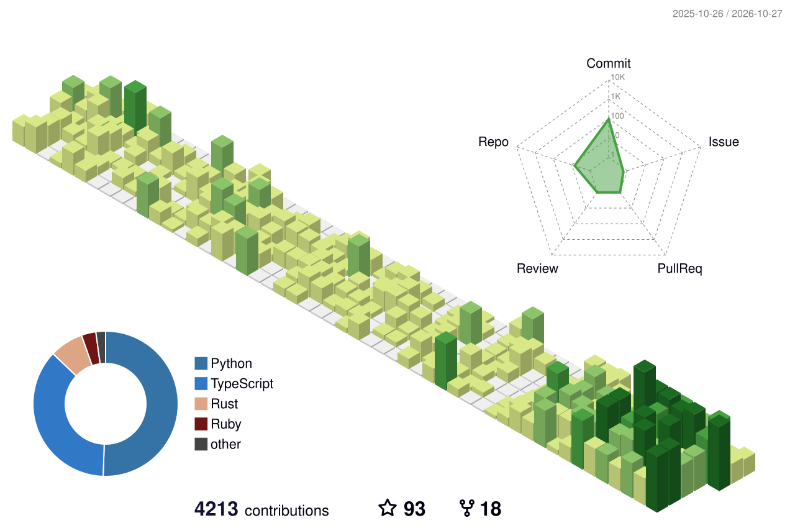

<h2 align="center">Hi, I'm Rishabh</h2>

  Founding AI Engineer @ <b>faff</b> · Bangalore · Mumbai 
  Building autonomous agents that do the real work.

  
  
  
  
  

---

### What I'm doing

- **Now:** Founding AI Engineer at faff. Production voice AI, realtime call evals and observability, and agents that handle bookings, cancellations and payments end to end.
- **Before:** led Vaani at Inka Insurance, a conversational AI platform for insurance used by 80,000+ people. Before that, founding engineer at SSingularity, shipping products for clients like Tata, Deloitte and Toyota.
- **Also:** I mentor engineers on careers, interviews and resumes, and I like security work and CTFs on the side.

### Stats

  
  

<picture>
  <source media="(prefers-color-scheme: dark)" srcset="./profile-3d-contrib/profile-night-green.svg"/>
  
</picture>
